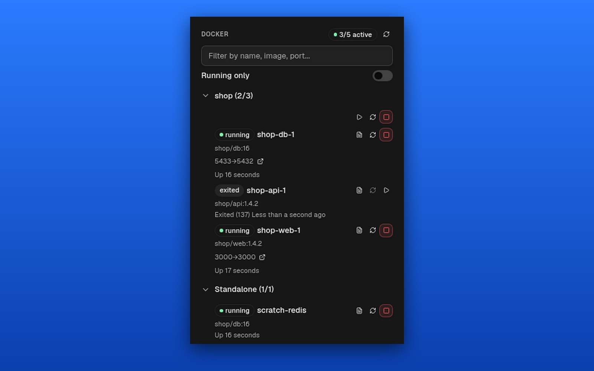

# Docker Containers for Orca

See and control your Docker containers without leaving [Orca](https://onorca.dev). A panel in the
right sidebar lists every container, grouped by Docker Compose project, and updates the moment
something starts or stops.


## Features

- **Grouped by project.** Containers are grouped by their Docker Compose project; the rest go under
  "Standalone". Projects with running containers come first.
- **Live.** Listens to `docker events`, so the list updates instantly, even when you start or stop
  something from a terminal. A 30-second refresh is kept as a safety net.
- **Status at a glance.** State badge, image, published ports and the status text from Docker.
- **Actions.** Start, stop and restart a container, or a whole Compose project at once.
- **Logs.** The last 200 lines of any container, right in the panel.
- **Open a port.** One click opens `http://localhost:<port>` in your browser.
- **Filter.** Search by name, image, project or port, or show running containers only.
- **Helpful errors.** Tells you when Docker is missing, stopped, or you lack permission, and how to fix it.
- **English and Portuguese**, following Orca's language.



## Requirements

- Orca with plugins enabled (Settings → Plugins).
- The `docker` CLI on the `PATH` of the user running Orca, able to reach the Docker daemon.

## Install

In Orca: Settings → Plugins → Add plugin → From a Git URL, then paste:

```
https://github.com/ricardo-benicio/orca-docker-containers
```

Or from the terminal:

```sh
orca plugin install ricardo-benicio/orca-docker-containers
```

Orca shows what the plugin can access and asks you to approve it before it runs. Open the **Docker**
icon in the right sidebar tabs.

## Security

This plugin runs a Node worker with your user's access (`trusted-worker`), which is why Orca asks for
explicit approval. What it does, in full:

- Runs only `docker ps`, `docker logs`, `docker events` and `docker start|stop|restart <id…>`,
  through `execFile` (no shell).
- Rejects any container id that is not hexadecimal, any project name that is not a valid Compose
  name, and any action outside start, stop and restart, before calling Docker.
- Never deletes containers, images or volumes.
- Makes no network requests. The only link it opens is `http://localhost:<port>` for a port you
  click, in your browser.
- Stores nothing except the panel's own preferences (filter text, collapsed groups).

## Development

```sh
orca plugin validate .
orca plugin test .          # parsers, worker and panel tests
orca plugin check .         # renders the panel in four states
orca plugin dev watch . --check
node --test src/docker.test.ts src/i18n.test.ts   # the pure tests, no Orca needed (what CI runs)
```

## Releasing

Bump `version` in `orca-plugin.json`, commit, then `git tag -a vX.Y.Z -m vX.Y.Z && git push origin vX.Y.Z`.
Users get it with `orca plugin update`.

## Português

Painel na barra lateral direita do Orca que lista os containers do Docker, agrupados por projeto do
Compose, e atualiza na hora em que algo inicia ou para. Permite iniciar, parar e reiniciar um
container ou o projeto inteiro, ver os logs, abrir uma porta no navegador e filtrar por nome, imagem,
projeto ou porta. A interface segue o idioma do Orca (inglês ou português).

Requer o comando `docker` no `PATH` do usuário que roda o Orca. O worker roda com o acesso do seu
usuário, por isso o Orca pede aprovação; ele só executa os comandos listados em "Security" acima.

## License

MIT
