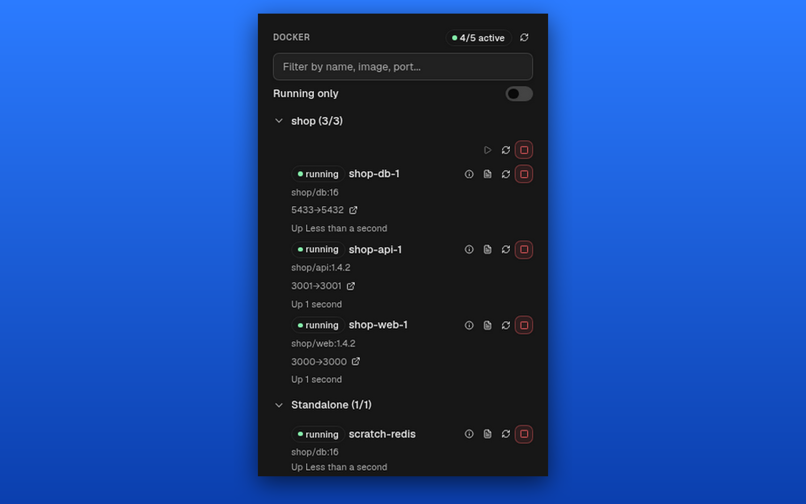
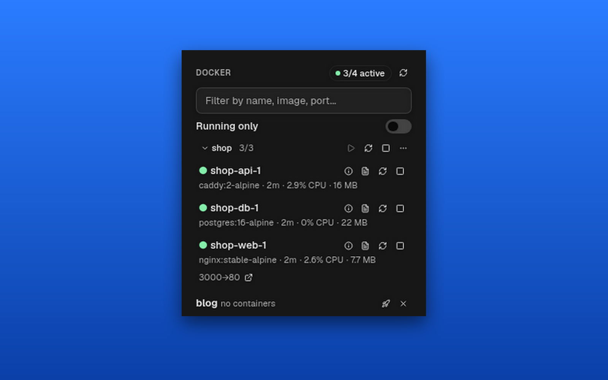

# Docker Containers for Orca

See and control your Docker containers without leaving [Orca](https://onorca.dev). A panel in the
right sidebar lists every container, grouped by Docker Compose project, and updates the moment
something starts or stops.



## Features

- **Grouped by project.** Containers are grouped by their Docker Compose project; the rest go under
  "Standalone". The project whose Compose folder is inside the workspace you are viewing goes first,
  tagged `this workspace`; after that, projects with running containers come first.
- **Live.** Listens to `docker events`, so the list updates instantly, even when you start or stop
  something from a terminal. A 30-second refresh is kept as a safety net.
- **Status at a glance.** Two compact lines per container: a coloured dot (filled when running, hollow when stopped), the image, a short uptime like `3h` and the published ports. A state word appears only when it matters (`unhealthy`, `restarting`, `paused`, `exited (3)`), and containers that need attention get a tinted row.
- **CPU and memory.** Each running container shows its CPU and memory, refreshed every 5 seconds while the panel is visible. Memory above 75% of the container's limit turns amber and above 90% red; CPU above 80% turns amber. Turn it off in Settings → Plugins if you prefer fewer Docker calls.
- **Compose Up and Down.** The `...` button in a project header opens **Up** (`docker compose up -d`
  with the files Docker recorded when you first started it) and **Down** (stops and removes the
  containers and the network, never the volumes, after you confirm). Both run in an Orca terminal, so
  you see the progress, the image downloads and any error. A project stays in the list after a
  `down`, with an Up button, until you click Forget.
- **Actions.** Start, stop and restart a container, or a whole Compose project at once, with the project buttons in the group header. Stopping or restarting a whole project asks for confirmation first (starting does not). Click the project name to collapse it.
- **Logs.** The last 200 lines of any container, right in the panel, or follow them live in an Orca terminal.
- **Shell.** Open a shell inside a running container in a new Orca terminal (bash if the image has it, otherwise sh).
- **Details and diagnostics.** Why a container is in its state: exit code, out-of-memory kill, the runtime error Docker reported, restart count, start and finish time, health status and the output of the last health check. Plus image, command, restart policy, memory limit, networks and volumes. Never environment variables or labels.
- **Status bar.** A `running/total` counter you can click to toggle the sidebar, plus a `Docker: Show running containers summary` command in the palette and the `Mod+Alt+D` shortcut.
- **Notifications.** A desktop notification when a container crashes (non-zero exit), runs out of memory or turns unhealthy. Normal stops are ignored and repeats are throttled.
- **Open a port.** One click opens `http://localhost:<port>` in your browser.
- **Filter.** Search by name, image, project or port, or show running containers only.
- **Settings.** Docker binary, Docker context (for example Colima or a remote host), refresh interval, notifications and status bar can all be changed in Settings → Plugins.
- **Helpful errors.** Tells you when Docker is missing, stopped, or you lack permission, and how to fix it.
- **English and Portuguese**, following Orca's language.




## Requirements

- Orca with plugins enabled (Settings → Plugins).
- The `docker` CLI on the `PATH` of the user running Orca, able to reach the Docker daemon.

## Install

In Orca: Settings → Plugins → Add plugin → From a Git URL, then paste:

```
https://github.com/ricardo-benicio/orca-docker-containers
```

Or from the terminal:

```sh
orca plugin install ricardo-benicio/orca-docker-containers
```

Orca shows what the plugin can access and asks you to approve it before it runs. Open the **Docker**
icon in the right sidebar tabs.

## Security

This plugin runs a Node worker with your user's access (`trusted-worker`), which is why Orca asks for
explicit approval. Version 0.3.0 asked for more than 0.2.0; 0.4.x to 0.8.x ask for nothing new. Here
is what each permission is used for, and nothing else:

| Permission | Used for |
| --- | --- |
| Run its own code | Talking to the `docker` CLI and watching `docker events` |
| `terminal:send` | Opening one terminal in your focused workspace when you press **Open shell** or **Follow logs**. Orca describes this permission broadly (it also covers typing into terminals); the plugin only calls `terminal.create`. |
| `workspace:read` | Finding the focused workspace: its id (to open terminals there) and its folder (to highlight the Compose project that lives in it). The worker reads your workspace list to find that one; only its name and folder reach the panel. |
| `notifications:show` | The crash, out-of-memory and unhealthy notifications |
| `settings:own` | Reading this plugin's own settings |
| `storage:own` | Remembering the panel's filter and collapsed groups, and where your Compose projects live (folder and files, up to 30 projects), so Up still works after a Down |

What the worker runs:

- `docker ps`, `docker inspect`, `docker logs`, `docker events`, `docker stats --no-stream` and `docker start|stop|restart <id…>`,
  through `execFile` (no shell).
- In a terminal, only `docker exec -it <id> sh -c '…bash or sh…'`, `docker logs -f --tail 200 <id>`,
  `docker compose -p '<project>' --project-directory '<dir>' -f '<file>'… up -d` and
  `docker compose -p '<project>' down`. The id is checked to be hexadecimal, and the docker command
  and context you configure are checked to contain only letters, digits and `./_+@-`, so nothing can
  be injected into the terminal line. The Compose folder and files come from labels Docker stored on
  your containers; each path must be absolute, short and free of quotes and control characters, and
  goes between single quotes. `down` never uses `-v` or `--rmi`, so volumes and images stay.
- It rejects invalid ids, project names and actions before calling Docker.
- It never deletes containers, images or volumes, and never sends environment variables or labels
  to the panel: from the labels it keeps only the Compose project name and folder. The details view
  shows the state, error text and last health check output that `docker inspect` reports (truncated
  to 300 characters), which are the same kind of text you would see in the logs.
- It makes no network requests. The only link it opens is `http://localhost:<port>` for a port you
  click, in your browser.

## Development

```sh
orca plugin validate .
orca plugin test .          # parsers, worker and panel tests
orca plugin check .         # renders the panel in four states
orca plugin dev watch . --check
node --test src/docker.test.ts src/i18n.test.ts src/config.test.ts src/alerts.test.ts   # the pure tests, no Orca needed (what CI runs)
```

## Releasing

Bump `version` in `orca-plugin.json`, commit, then `git tag -a vX.Y.Z -m vX.Y.Z && git push origin vX.Y.Z`.
Users get it with `orca plugin update`.

## Português

Painel na barra lateral direita do Orca que lista os containers do Docker, agrupados por projeto do
Compose, e atualiza na hora em que algo inicia ou para. Permite iniciar, parar e reiniciar um
container ou o projeto inteiro, ver os logs, abrir uma porta no navegador e filtrar por nome, imagem,
projeto ou porta. A interface segue o idioma do Orca (inglês ou português).

Requer o comando `docker` no `PATH` do usuário que roda o Orca. O worker roda com o acesso do seu
usuário, por isso o Orca pede aprovação; ele só executa os comandos listados em "Security" acima.

## License

MIT
